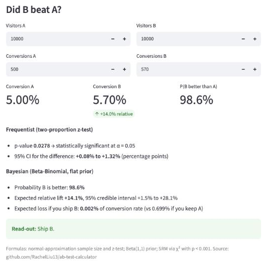

# 🧪 A/B Test Calculator


A small Streamlit app for the three questions every conversion experiment raises:

1. **Plan** — how many visitors, and how many days, to detect the lift you care about?
2. **Analyze** — did B beat A? Read out two ways: a classical z-test *and* a Bayesian probability-to-beat
   with expected loss, which is easier to explain to non-statisticians.
3. **Sanity check** — did traffic split the way it was designed? A *sample ratio mismatch* usually means
   an assignment or logging bug, and the result shouldn't be trusted until it's explained.



## Example

| Question | Input | Answer |
|---|---|---|
| Plan | 10% baseline, detect a 10% relative lift, α = 0.05, 80% power | **14,751 visitors per group** |
| Analyze | A: 500 / 10,000 · B: 570 / 10,000 | p = 0.028; P(B better) = 98.6%; expected loss of shipping B 0.002 pts → ship B |
| Sanity check | 50,000 vs 51,500 visitors on a 50/50 design | Mismatch (p < 0.001) — investigate before reading results |

## Run it

```bash
pip install -r requirements.txt
streamlit run app.py
pytest -q
```

## Methods

| Piece | Method |
|---|---|
| Sample size | Normal approximation for two independent proportions (unpooled variances) |
| Significance | Two-proportion z-test (pooled SE) with a Wald 95% CI for the difference |
| Bayesian | Independent Beta(1, 1) priors, 200k Monte Carlo draws: P(B > A), relative lift interval, expected loss |
| SRM | χ² goodness-of-fit against the designed split, flagged at p < 0.001 |

The sample size and z-test are checked against `statsmodels` in the test suite.

## Layout

```
abtest/frequentist.py   sample size, z-test
abtest/bayesian.py      Beta-Binomial posterior read-out
abtest/quality.py       sample-ratio-mismatch check
app.py                  Streamlit interface
tests/                  unit tests (pytest)
```
